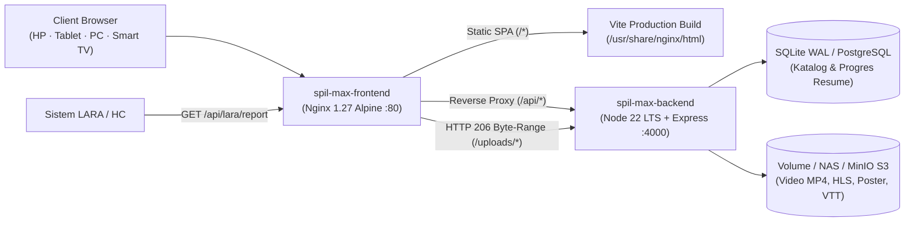

# Dokumen Handover Infrastruktur & Deployment — SPIL MAX

Dokumen ini disiapkan untuk **Tim IT / DevOps PT Salam Pacific Indonesia Lines (SPIL)** guna mempermudah proses *deployment*, integrasi SSO karyawan, pengelolaan penyimpanan video, serta integrasi pelaporan **LARA** (*Learning Automation for Reporting Administration*).

---

## 1. Arsitektur Sistem



### Komponen Utama
| Layanan | Direktori | Teknologi | Port Internal | Fungsi |
| :--- | :--- | :--- | :--- | :--- |
| **Frontend Web & Reverse Proxy** | `./frontend` | React 18, TypeScript, Vite 6, Tailwind CSS, Nginx 1.27 | `80` (publik: `8080`) | Antarmuka Apple TV+, Liquid Glass Video Player (MP4 & HLS `.m3u8`), Studio Kurator (`/studio`), & proxy `/api` + `/uploads`. |
| **Backend REST API** | `./backend` | Node.js 22 LTS, Express 4, TypeScript, `node:sqlite` (WAL) | `4000` | Katalog modul/level dinamis, sinkronisasi *Continue Where I Left Off*, upload berkas media hingga 500 MB, & ekspor laporan LARA. |

---

## 2. Opsi Deployment Produksi

### Opsi A — Docker Compose (Direkomendasikan untuk VM / On-Premise Linux SPIL)
Prasyarat: **Docker Engine ≥ 24** & **Docker Compose v2**.

```bash
# 1. Clone repositori cabang produksi (main)
git clone -b main https://github.com/RinaliDaffa/SPIL-MAX.git
cd SPIL-MAX

# 2. Salin konfigurasi environment
cp .env.example .env
# Sesuaikan APP_PORT (mis. 8080) dan CORS_ORIGIN (mis. https://elearning.spil.co.id)

# 3. Build & jalankan container di background
docker compose up -d --build

# 4. Verifikasi status kesehatan layanan (Healthcheck)
curl http://127.0.0.1:8080/api/health
```

Kedua data penting tersimpan aman pada *named Docker volumes* (tidak hilang saat container di-*rebuild*):
- `spil_max_db` (`/data/spil-max.sqlite`) — Database modul, episode, watchlist, dan progres detik tontonan karyawan.
- `spil_max_uploads` (`/uploads`) — Berkas `.mp4`, `.vtt`, dan poster yang diunggah melalui **Studio Kurator (`/studio`)**. Tim IT dapat mengarahkan volume ini ke mount **NAS / NFS** perusahaan.

### Opsi B — Bare-Metal / VM Tanpa Docker (Node.js 22 LTS + PM2 + Nginx)
Prasyarat: **Node.js ≥ 22.5.0 LTS** (wajib Node 22+ karena menggunakan modul bawaan `node:sqlite` tanpa kompilasi C++ `node-gyp`).

```bash
# 1. Build Backend & Frontend
npm run install:all
npm run build

# 2. Jalankan Backend dengan PM2
PORT=4000 \
DATABASE_PATH=/var/lib/spil-max/spil-max.sqlite \
UPLOAD_DIR=/var/lib/spil-max/uploads \
pm2 start backend/dist/server.js --name spil-max-backend

# 3. Arahkan root Nginx ke `frontend/dist` dengan acuan `frontend/nginx.conf`
```

---

## 3. Integrasi SSO / Identitas Karyawan SPIL

Backend membaca identitas karyawan pada setiap request melalui HTTP Header yang dapat disuntikkan oleh **API Gateway / Reverse Proxy SSO SPIL** (mis. OAuth2 Proxy / Keycloak / Portal Internal):

| Header | Contoh Nilai | Keterangan |
| :--- | :--- | :--- |
| `X-Employee-Id` | `SPIL-2024-0891` | NIK / ID unik karyawan (kunci utama progres *Continue Where I Left Off* & LARA). |
| `X-Employee-Name` | `Budi Santoso` | Nama lengkap karyawan untuk ditampilkan pada profil navigasi. |
| `X-Employee-Division` | `Port & Terminal Operations` | Nama divisi / cabang karyawan. |

> [!NOTE]
> Apabila header di atas belum disuntikkan (seperti pada lingkungan *staging* atau *demo*), sistem otomatis menggunakan akun demo `SPIL-EMP-001` (*Jason Duval*).

---

## 4. Spesifikasi Endpoint REST API Utama

| Method & Path | Fungsi |
| :--- | :--- |
| `GET /api/health` | *Liveness & readiness probe* untuk Docker/Kubernetes/Load Balancer. |
| `GET /api/catalog` | Mengambil seluruh daftar modul beserta urutan level videonya (`Level 1`–`Level 4`). |
| `POST /api/modules` | Membuat modul kompetensi baru (dipanggil dari halaman `/studio`). |
| `POST /api/modules/:id/episodes` | Menambahkan video level baru ke modul yang sudah ada. |
| `DELETE /api/modules/:id` | Menghapus modul dari katalog. |
| `POST /api/upload` | Mengunggah berkas `.mp4`, `.webm`, `.jpg`, `.png`, `.webp`, atau `.vtt` (Header: `X-Filename`). |
| `GET /api/state` | Mengambil `progress` (*Continue Where I Left Off*), `watchedEpisodes`, dan `myList` milik karyawan aktif. |
| `PUT /api/progress` & `POST /api/progress` | Menyimpan posisi detik tontonan (`currentTime`, `duration`) secara berkala dan via `navigator.sendBeacon` saat tab ditutup. Otomatis menandai selesai pada progres `≥ 90%`. |
| `GET /api/lara/report` | Mengekspor rekap progres dan penyelesaian modul dalam format JSON (tambahkan `?format=csv` untuk unduhan berkas CSV LARA). |

---

## 5. Migrasi ke PostgreSQL & Object Storage (Opsional Skala Enterprise)

1. **Database PostgreSQL**:
   Skema SQLite pada `backend/src/db.ts` telah dirancang 1-banding-1 dengan skema PostgreSQL yang sudah disiapkan di [`backend/sql/schema.postgres.sql`](../backend/sql/schema.postgres.sql). Apabila trafik melebihi ribuan pengguna konkuren secara bersamaan, Tim IT cukup mengeksekusi DDL tersebut pada cluster PostgreSQL internal dan mengganti pemanggilan query di `backend/src/db.ts` menggunakan paket `pg`.
2. **Streaming Video Skala Besar (CDN / MinIO / HLS)**:
   Player video pada `frontend/src/components/AppleTvPlayer.tsx` telah dilengkapi plugin **`hls.js`**. Untuk video berdurasi panjang (> 30 menit), Tim IT sangat disarankan menaruh berkas video pada **MinIO / S3 / Internal CDN** dalam format HLS adaptif (`.m3u8`) atau MP4 *fast-start* (`-movflags +faststart`), lalu menempelkan URL-nya melalui halaman **Studio Kurator (`/studio`)**.
